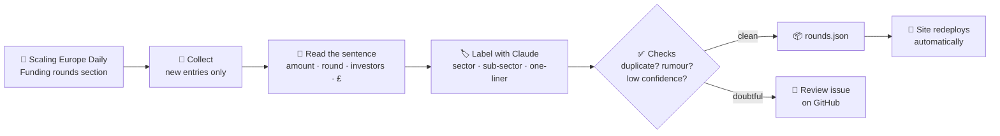

# 📊 The Funding Dashboard

**1,500+ of the biggest funding rounds tracked across Europe in 2026. Searchable, filterable, and updated automatically every weekday.**

[](https://europe-venture.vercel.app)


---

## 1. What it is

| | |
|---|---|
| 🔵 **The state of 2026** | Every round is one dot, grouped by month and coloured by sector |
| 🔎 **Search in plain words** | *"UK infrastructure startups raising £10–100m"* becomes filters automatically |
| 🎛️ **Filters** | Country, sector, sub-sector, stage, round size, month |
| 📈 **Analytics** | Capital by month, sector treemap, country profiles (UK, Germany, Netherlands, France, Sweden) |
| 🗺️ **Funding map** | Hover a country to see its biggest rounds |
| 🔗 **Full profile per round** | Other raises by the same company, plus a link to the original article |

All amounts are in GBP at monthly average exchange rates. Source: the [Scaling Europe Daily](https://scalingeurope.substack.com) newsletter; every round links to the original article.

---

## 2. How it works



### The daily run (weekdays, 09:30 · 13:00 · 15:30 UTC)

| # | Step | What happens | Built with |
|---|---|---|---|
| 1 | **Collect** | Reads the newsletter feed and keeps only the *💰 Funding rounds* entries. A small pass-through on the site fetches the feed, because Substack blocks GitHub's servers | Python, a Vercel function |
| 2 | **Read** | Rules pull out amount, round type and investors; amounts convert to £ at the monthly average rate | Regex rules, ECB rates via Frankfurter |
| 3 | **Locate** | Country comes from the article link ("berlin-based…", "swedens-…") or the sentence. Never guessed | Rules |
| 4 | **Label** | AI assigns a sector, sub-sector and one-line description from a fixed taxonomy. Every answer is checked before it is trusted | Claude Haiku 5.5 |
| 5 | **Check** | Repeats are skipped; rumours and low-confidence rows are held for a human | Rules |
| 6 | **Publish** | New rows are added to `rounds.json` in one commit and the site rebuilds | GitHub Actions, Vercel |
| 7 | **Watch** | A failed run emails you and opens an alert issue; the site's *Last updated* date only moves after a fully successful run | GitHub Issues |

**Where a human steps in:** held rows appear as a GitHub issue. Set `"approved": true` in `data/staged/held_rows.json` to publish one, or delete it to drop it.

---

## 3. Built with

**Site:** React · Vite · Vercel  
**Pipeline:** Python 3.12 · GitHub Actions · Claude API · pytest (90 tests)  
**Data:** one file, `rounds.json`

---

## Repo map

| Path | What it is |
|---|---|
| `FundingDashboard.jsx`, `lib.js` | The website |
| `rounds.json`, `status.json` | The data and the last-updated date |
| `europe-map.json` | Fixed map geometry |
| `pipeline/` | The daily pipeline: collect → build rows → notify |
| `api/substack-feed.js` | Pass-through that fetches the newsletter feed |
| `.github/workflows/daily-update.yml` | The schedule |
| `data/` | The pipeline's saved state and review queue |

## Run it locally

```bash
npm install && npm run dev                      # the site
pip install -r pipeline/requirements.txt
python -m pytest pipeline/tests                 # the pipeline's tests
python pipeline/daily.py --dry-run              # a full simulated day, saves nothing
```

The AI step needs an `ANTHROPIC_API_KEY`; the scheduled run needs the repository secrets `ANTHROPIC_API_KEY` and `FEED_PROXY_URL`.

---

**Contact:** [LinkedIn](https://www.linkedin.com/in/dhruv-banerjee-514983287/) · [dhruvb363@gmail.com](mailto:dhruvb363@gmail.com)
